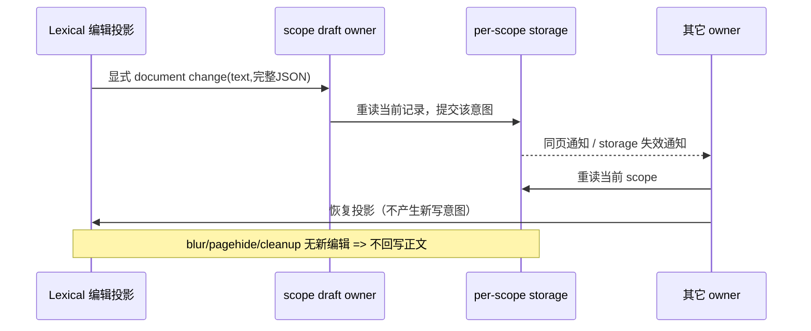

# Task-scoped composer drafts

## 背景

聊天输入框的未发送状态必须跟随 task 隔离，而不是跟随当前组件实例。用户在 A task 输入文本、添加附件或上下文 chip 后切到 B task，再切回 A task，应看到 A 自己的草稿；B task 也同理。

## 缓存边界

- workspace 隔离使用 `workspaceKey = workspaceIdentity?.trim() || workspacePath`。
- 草稿作用域使用 `taskId`；新建任务态使用 `null`，在 store 中映射为 `__draft__`。
- v4 每个作用域持久化正文、Lexical JSON、mention、模型/模式/Plan、启动补充与本地 revision；附件及其它上下文沿现有 renderer hooks 管理，不进入这个持久化记录。
- 桌面端恢复时优先重放 Lexical editor JSON 快照，保留 mention / token 节点；旧草稿或快照缺失时回退到纯文本恢复。
- focus、拖拽高亮、提示词增强 loading 等瞬时 UI 状态不进入草稿缓存。

## v4 持久化与并发规则

- v4 的唯一草稿所有者为 `useDraftConfigControl`；Lexical 是其编辑投影，`composerDraftStore` 是持久化与失效通知入口。普通附件仍不持久化，不改变现有附件边界。
- 每个 workspace identity/task scope 使用独立 localStorage key；旧 workspace v1 包只读兼容，不批量迁移。首次正常写入只写该 scope 新 key；显式删除写 tombstone，禁止旧记录复活。
- 正文、预填、撤回恢复、模型/模式/Plan 与 taskStart 都是显式编辑意图。正文编辑立即提交完整 text/editorStateJson，按写前最新草稿保留其余配置；不再由 blur/pagehide/cleanup 把旧编辑器快照提交为新正文。
- 恢复前先通过编辑器 flushPendingChanges 提交已排队的真实文档变更，再核对 scope/编辑 revision；新的输入优先，不能在恢复 setter 内部才 flush 后继续覆盖。专用恢复 tag 只屏蔽恢复回调，不屏蔽普通预填。
- 同页写入同步失效通知其它 owner；跨 renderer 的 storage 事件只触发重读当前记录，不直接应用可能乱序的 event.newValue。恢复和通知不回环写入；旧 scope 闭包无权修改新 scope。
- 同一 scope 最后一次显式完整记录写入获胜。localStorage 不提供跨 renderer CAS；本规则不承诺真正同时的不同字段修改会自动合并。不同 scope 的键互不覆盖。
- Plan transition 和 permission grant 的不透明 ID 在 scope 草稿的可选已消费集合中去重；legacy lastId 是消费种子。已消费 ID 在不同 owner、乱序通知及重挂载后不能再次覆盖手动选择；新 ID 仍正常消费，不按时间/字典猜事件顺序。集合随 replace/promotion 保留，无批迁移或任意截断。
- 初始化和工具 Plan transition 消费必须检查最新记录，不能用旧 owner 的默认值覆盖已初始化配置。外来正文更新恢复编辑器，本地编辑不重置光标。
- 发送成功只清正文及启动补充；promotion、迟到 ACK、存储失败和旧记录的模型/mention/Plan 兼容保持。

## 验收

覆盖旧 owner 自动保存、同步/延迟/乱序通知、新显式编辑保留最新配置、不同 scope/远端 identity、旧包读取/tombstone、同文富节点、程序恢复、promotion/配额失败。真实浏览器多 owner 与跨 renderer 验证分别标注；组件测试不等于已验证两个用户窗口的所有时序。

## 已知边界（未修复，组合失败场景未验证）

- **配额失败与跨窗口延迟通知叠加**：`useDraftConfigControl.ts` 在本 owner 的写入失败后保留未保存意图，下一次编辑以本地 `previous` 为基底。若另一个窗口期间成功写入同 scope，但其 storage 失效通知尚未被当前 owner 处理，当前 owner 随后成功写入完整记录，可能覆盖另一窗口更新的其它字段。正常写前重读、通知先到后的重读/清标记已有保护；现有“配额失败”和“迟到通知前编辑”测试分别覆盖，不代表两者叠加已通过。不推断发生概率或宣称不会丢失更新。
- **promotion 目标写入成功、Root tombstone 写入失败**：`promoteComposerDraft` 先写 Session scope，再调用 `clearV4ComposerDraft` 清 Root，未检查清理返回值，也无补偿/重试。若目标写成功而 Root tombstone 写失败，会留下双 scope；现有目标写失败保留 Root 的测试不覆盖这一分支。双 scope 并存不等于已发生重复发送，实际用户表现仍需故障注入与双窗口验收。

这两项在 B05 列表续行修复中仅登记，不修改草稿持久化/并发行为，也不计入已修复或验收通过清单。
